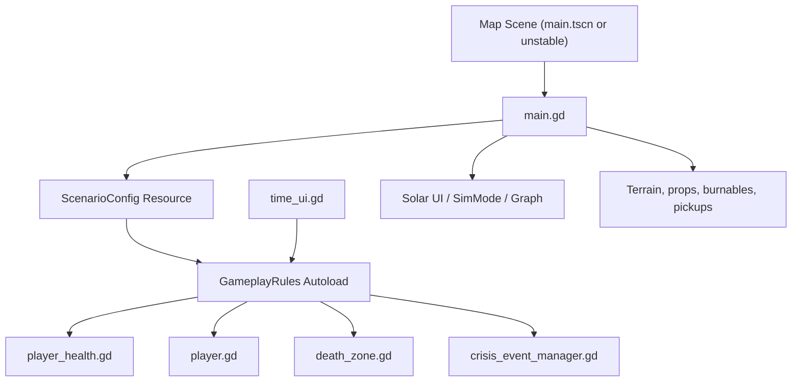

# Phase 4 design — Module boundaries and scenario config

**Status:** implemented — see `gameplay/gameplay_rules.gd`, `scenarios/scenario_config.gd`, and `GameplayRules` autoload in `project.godot`.

Phase 4 should separate three concerns without rewriting the simulator:

1. **Solar / electrical simulation** — shared across maps.
2. **Survival / death / hydration / crisis mechanics** — optional per map/build.
3. **Map-specific content** — terrain, art, burnable scan roots, fire pickups, HA entity profile, spawn points.

The safest approach is an incremental rules/config layer that keeps existing scenes working while moving hardcoded decisions out of `main.gd`.

---

## Current coupling points

### Shared solar/electrical systems

Primary files:

- `main.gd` — clock, sun/moon, `weather_light_factor`, save/load orchestration.
- `solar_ui.gd` — PV/load/battery sim, HA entity bindings, weather lighting, rain/mud visuals.
- `sim_mode.gd` — autoload deciding live/sim/historical mode.
- `inverter_bridge.gd` — HA hardware entity bridge.
- `power_system/`, `system_graph/`, `system_graph_v2/` — devices, graph, automation.

Important coupling:

- `sim_mode.gd` hardcodes `Main/UILayer/SolarUI`, `UILayer/SolarUI`, and a scene root named `Main`.
- `main.gd` save/load uses `UILayer/SolarUI` and `UILayer/SystemGraphView`.
- `solar_ui.gd` mostly finds the main node by properties, but still has some map-ish visuals (`Main/Player`, `Main/FloorMesh`, rain/mud).
- `inverter_bridge.gd` has physical install entity IDs. This should become a later profile/config concern, not part of the first survival split.

### Survival / crisis systems

Primary files:

- `main.gd`
- `player.gd`
- `player_health.gd`
- `health_ui.gd`
- `game_over_ui.gd`
- `death_zone.gd`
- `hydration_station.gd`
- `crisis_events/`
- `player_tools/`

Important coupling:

- `main.gd` has one broad `gameplay_mechanics_paused` flag.
- `player_health.gd` uses that flag to stop hydration, regen, dehydration damage, fire proximity checks, and fire damage.
- `player.gd` uses the same flag for fall damage.
- `death_zone.gd` ignores the flag, so "survival off" does not disable instant-kill volumes.
- `time_ui.gd` writes directly to `main_node.gameplay_mechanics_paused`.
- `system_graph/system_graph_view.gd` also toggles `gameplay_mechanics_paused` while the graph is open.
- `main.gd` hardcodes fire extinguisher pickup positions and burnable scan roots.
- `crisis_event_manager.gd` reads `main_node.enable_random_fires` and `gameplay_mechanics_paused`.

---

## Proposed architecture

Add two small pieces:

1. `GameplayRules` autoload — runtime feature/rules singleton.
2. `ScenarioConfig` resource — optional per-map data that applies to `GameplayRules` and map setup.

Keep `main.gd` as the clock and scene orchestrator for now. Do **not** split solar math out of `main.gd` in the first implementation pass.



### `GameplayRules` responsibility

Runtime source of truth for optional gameplay systems:

- `survival_enabled`
- `survival_paused`
- `health_enabled`
- `hydration_enabled`
- `fall_damage_enabled`
- `death_zones_enabled`
- `fire_damage_enabled`
- `crisis_events_enabled`
- `random_crises_enabled`
- `fire_tools_enabled`
- `show_survival_ui`

Suggested public API:

```gdscript
func is_survival_active() -> bool
func is_health_enabled() -> bool
func is_hydration_enabled() -> bool
func is_fall_damage_enabled() -> bool
func is_death_zones_enabled() -> bool
func is_fire_damage_enabled() -> bool
func is_crisis_events_enabled() -> bool
func is_random_crises_enabled() -> bool
func is_fire_tools_enabled() -> bool
func should_show_survival_ui() -> bool
func set_survival_paused(paused: bool) -> void
func apply_scenario(config: ScenarioConfig) -> void
```

Compatibility rule:

- Keep `main.gd.gameplay_mechanics_paused` for now.
- `time_ui.gd` should update both `GameplayRules.set_survival_paused(paused)` and `main_node.gameplay_mechanics_paused = paused`.
- Existing save files should still load.

### `ScenarioConfig` responsibility

Map-level intent, not live runtime state.

Suggested fields:

```gdscript
@export var display_name: String = "Default Scenario"
@export var solar_enabled: bool = true
@export var survival_enabled: bool = true
@export var health_enabled: bool = true
@export var hydration_enabled: bool = true
@export var fall_damage_enabled: bool = true
@export var death_zones_enabled: bool = true
@export var fire_damage_enabled: bool = true
@export var crisis_events_enabled: bool = false
@export var random_crises_enabled: bool = false
@export var fire_tools_enabled: bool = false
@export var show_survival_ui: bool = true
@export var burnable_scan_node_paths: PackedStringArray = []
@export var extinguisher_pickups: Array[Dictionary] = []
```

Initial defaults should preserve current behavior as closely as possible:

- `survival_enabled = true`, but `GameplayRules.survival_paused = true` until `TimeUI` or save/load changes it.
- `crisis_events_enabled = enable_random_fires or spawn_extinguisher_pickups` as a fallback when no config exists.
- `random_crises_enabled` should mirror existing `main.gd.enable_random_fires`.
- `fire_tools_enabled` should mirror existing `main.gd.spawn_extinguisher_pickups`.

---

## Implementation sequence for Composer 2

Composer 2 Fast should be able to handle the mechanical implementation once this design is accepted.

### Step 1 — Add rules singleton

Add:

- `gameplay/gameplay_rules.gd`

Update:

- `project.godot` autoloads:
  - `GameplayRules="*res://gameplay/gameplay_rules.gd"`

Rules should default to the current startup behavior: survival systems exist, but survival is initially paused.

### Step 2 — Add scenario resource

Add:

- `scenarios/scenario_config.gd`
- Optional starter resources later:
  - `scenarios/mars_aerial_scenario.tres`
  - `scenarios/soak_camp_scenario.tres`

Update `main.gd`:

- Add `@export var scenario_config: ScenarioConfig`.
- In `_ready()`, call a helper like `_apply_scenario_config()` before death zone, crisis, and pickup setup.
- If no config is assigned, derive rules from existing exports so current scenes do not break.

### Step 3 — Migrate survival gates

Update:

- `player_health.gd`
  - Replace `_is_gameplay_paused()` checks with `GameplayRules.is_survival_active()`.
  - Gate hydration separately with `GameplayRules.is_hydration_enabled()`.
  - Gate fire damage with `GameplayRules.is_fire_damage_enabled()`.
- `player.gd`
  - Gate fall death with `GameplayRules.is_fall_damage_enabled()`.
- `death_zone.gd`
  - Do not emit `player_died` if `not GameplayRules.is_death_zones_enabled()` or `not GameplayRules.is_survival_active()`.
- `health_ui.gd`
  - Hide or disable updates when `not GameplayRules.should_show_survival_ui()`.

### Step 4 — Keep UI compatibility

Update:

- `time_ui.gd`
  - Keep current checkbox behavior.
  - Route pause/unpause through `GameplayRules.set_survival_paused(paused)`.
  - Continue writing `main_node.gameplay_mechanics_paused` as a compatibility mirror.
- `main.gd`
  - Save/load both the old `gameplay_mechanics_paused` value and a new optional `gameplay_rules` block.
  - On old saves, apply the old field to `GameplayRules`.

### Step 5 — Data-drive crisis map setup

Update:

- `main.gd`
  - `_setup_crisis_events()` should use `scenario_config.burnable_scan_node_paths` first.
  - Keep existing `structure` and `"Mars 2026 - Aerial Located"` fallback when no config exists.
  - `_spawn_fire_extinguisher_pickups()` should use `scenario_config.extinguisher_pickups` first.
  - Keep existing hardcoded positions as fallback.
- `crisis_events/crisis_event_manager.gd`
  - Use `GameplayRules.is_crisis_events_enabled()` and `GameplayRules.is_random_crises_enabled()`.
  - Keep current time-scale pause behavior unless it causes regressions.

### Step 6 — Smoke tests

Manual test matrix:

| Test | Expected result |
|------|-----------------|
| Open `main.tscn` | Scene still runs with existing UI and solar behavior |
| Toggle survival in `TimeUI` | Health/hydration/fall/fire/death-zone behavior follows one rules source |
| Fast-forward time | Survival pauses as before |
| Enter death zone with survival active | Game over triggers |
| Enter death zone with survival disabled/paused | No game over |
| Random fires disabled | No random crisis fires |
| Random fires enabled in scenario/main export | Crisis manager can trigger fires |
| Save/load old save | Old `gameplay_mechanics_paused` still applies |
| Save/load new save | New rules block restores consistently |

---

## What not to do in Phase 4

- Do not split `solar_ui.gd` into model/view yet.
- Do not restructure `main.tscn` or `main- maybe unstable.tscn` yet.
- Do not add the map selection flow yet; that belongs to Phase 5.
- Do not remove `gameplay_mechanics_paused` until all current callers are migrated and old saves are handled.
- Do not change HA entity profile storage yet; that can be handled with map/profile config after the scene flow is cleaned up.

---

## Model recommendation

Use **Composer 2 Fast** for:

- Adding `GameplayRules` and `ScenarioConfig`.
- Mechanical gate replacements in `player_health.gd`, `player.gd`, `death_zone.gd`, `health_ui.gd`, `time_ui.gd`.
- Adding save/load compatibility fields.
- Adding fallback-based scenario config support in `main.gd`.

Use **GPT-5.5** for review/checkpoints if:

- `main.gd` changes start affecting solar/time behavior.
- Save compatibility becomes unclear.
- The refactor starts touching `solar_ui.gd`, `sim_mode.gd`, `system_graph/`, or scene restructuring.
- The first implementation breaks either map scene in a way that needs architectural judgment.

---

## Composer 2 prompt

Use this prompt for the next implementation pass:

> Implement Phase 4 from `PHASE4_MODULE_DESIGN.md`. Keep the change incremental and backwards compatible. Add `GameplayRules` as an autoload and `ScenarioConfig` as a Resource. Migrate survival/death/crisis gates to query `GameplayRules`, but keep `main.gd.gameplay_mechanics_paused` mirrored for compatibility with current UI, graph behavior, and old saves. Do not restructure scenes or split solar UI. Preserve current behavior when no `scenario_config` is assigned. After edits, run Godot/GDScript lint if available or at least check changed files for syntax/lint diagnostics.

