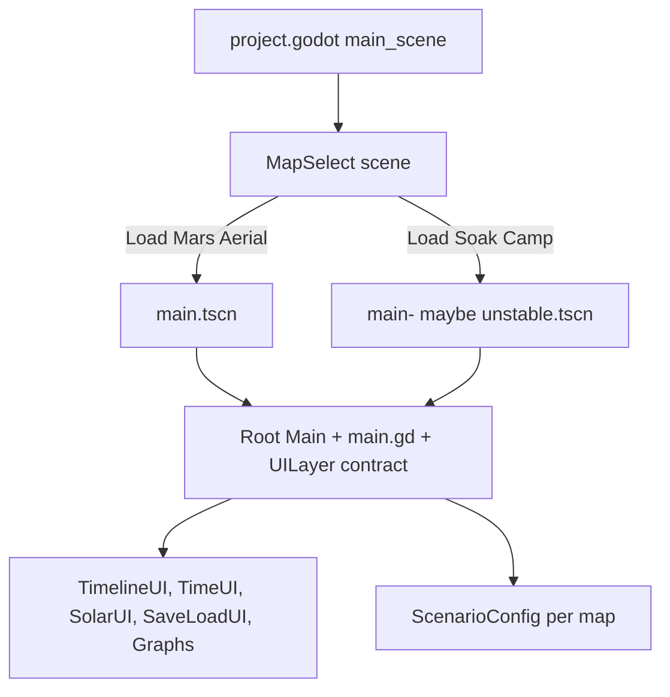

# Phase 5 design — Scene shell, map flow, and UI consistency

> **SUPERSEDED — historical archive (April 2026).** This documents a completed
> repo-hygiene / beta-readiness effort and is kept for provenance only. Its
> figures describe a 107-file, 7-autoload project with no `addons/`; the project
> is now ~540 `.gd` files and 33 autoloads. For current guidance see
> [`ARCHITECTURE.md`](ARCHITECTURE.md) (structure + debt backlog) and
> [`CLAUDE.md`](CLAUDE.md) (features + validation), which win on any conflict.

**Status:** design/risk handoff. **Update (restructure):** the Mars play map is **`scenes/maps/mars_aerial.tscn`** (formerly root `main.tscn`); SOAK is **`scenes/maps/soak_festival_2026.tscn`**. `project.godot` runs **`map_select`**, not a map directly. Body text below may still say `main.tscn` where behavior is unchanged.

One tactical fix is already applied: the Mars map includes `TimelineUI` under `UILayer`, matching `main- maybe unstable.tscn` / SOAK.

Phase 5 should let the user choose/switch maps while preserving shared UI, solar math, save/load, and Phase 4 scenario rules. The safest implementation is a **transitional scene shell** first, not a full persistent shared UI shell yet.

---

## Current state

- `project.godot` launches `res://scenes/ui/map_select/map_select.tscn` (map chooser).
- **`scenes/maps/mars_aerial.tscn`** and **`scenes/maps/soak_festival_2026.tscn`** (and legacy root `main- maybe unstable.tscn`) are self-contained root scenes named `Main` with `main.gd` where applicable.
- Both maps now have `UILayer/TimelineUI`, `TimeUI`, `SaveLoadUI`, `SolarUI`, graph views, and health/game-over UI.
- Many scripts assume the active scene root is the simulation host:
  - `sim_mode.gd` resolves `Main/UILayer/SolarUI` and a root named `Main`.
  - `timeline_ui.gd` resolves its parent’s parent as the node with lunar/time APIs.
  - `main.gd` save/load reads `UILayer/SolarUI`, `UILayer/SystemGraphView`, and `UILayer/TimelineUI`.
  - `SaveSystem` autosave uses the first node in group `main_scene`.

This means a fully persistent shell like `AppShell/MapSlot/Main` would break several assumptions unless resolvers are updated first.

---

## Recommended Phase 5 target

Implement a **menu/shell scene that changes into self-contained map scenes**:



This is a “scene shell” in user experience: one start menu and a consistent map contract. It avoids the higher-risk persistent UI shell until Phase 5 has stabilized.

---

## Required scene contract

Each playable map scene should keep:

- Root node named `Main`.
- Root script `res://scenes/maps/main.gd`.
- Group `main_scene` added by `main.gd`.
- `Player` child.
- `UILayer` child with these shared UI nodes:
  - `TimeUI`
  - `TimelineUI`
  - `SaveLoadUI`
  - `SolarUI`
  - `HealthUI`
  - `GameOverUI`
  - `InteractionPromptUI`
  - `SystemGraphView`
  - `SystemGraphViewV2`
  - `LocationPickerUI`
- Optional map-specific UI:
  - `MarsCollegeCreditsUI` only on the Mars/aerial map if desired.
- `scenario_config` assigned per map when map-specific survival/crisis behavior is ready.

Do not move `UILayer` outside the map scene in this phase.

---

## Implementation plan for Composer 2

### 1. Add map metadata

Add a small map descriptor resource:

- `maps/map_definition.gd`

Suggested fields:

```gdscript
class_name MapDefinition
extends Resource

@export var display_name: String
@export_file("*.tscn") var scene_path: String
@export var description: String = ""
@export var scenario_config: ScenarioConfig
@export var thumbnail: Texture2D
```

Add starter resources:

- `maps/mars_aerial_map.tres` → `res://main.tscn`
- `maps/soak_camp_map.tres` → `res://main- maybe unstable.tscn`

### 2. Add map select scene

Add:

- `scenes/ui/map_select/map_select.tscn`
- `scenes/ui/map_select/map_select.gd`

Responsibilities:

- Display available maps.
- Start selected map with `get_tree().change_scene_to_file(map.scene_path)`.
- Keep UI minimal: map name, short description, “Start”, optional “Quit”.
- Do not load maps as children yet.

### 3. Update startup

Update `project.godot`:

- `run/main_scene="res://scenes/ui/map_select/map_select.tscn"`

Keep direct scene testing supported: both `main.tscn` and `main- maybe unstable.tscn` should still run if opened directly in Godot.

### 4. Add in-game map switch affordance

Lowest risk option:

- Add a small “Map Select” button to `TimelineUI` or `TimeUI` that calls `get_tree().change_scene_to_file("res://scenes/ui/map_select/map_select.tscn")`.

Important behavior:

- Prompt or autosave before switching. Do not silently discard state.
- Keep first implementation simple: button returns to map select; map select loads the next scene.

### 5. Save/load scene routing

Current `main.gd` saves `"scene_path": "res://main.tscn"` for every map. This blocks loading directly into the correct map from the menu.

Phase 5 should change:

```gdscript
"scene_path": scene_file_path if not scene_file_path.is_empty() else "res://main.tscn"
```

Then add a helper in map select:

- Continue/load reads the save payload.
- If `scene_path` exists and differs from the currently loaded scene, switch to it first.
- After the scene loads, call `_apply_save_snapshot(data)` on the new `Main`.

If this is too much for the first Composer pass, leave cross-map save routing as a known limitation and only use map select for new sessions.

### 6. Standardize shared UI across maps

Already done:

- `main.tscn` now has `TimelineUI`.

Still verify:

- `main.tscn` and `main- maybe unstable.tscn` both have all required shared UI nodes.
- `SolarUI` entity IDs can still differ per map for now, but should eventually move into profile/config.
- `TimelineUI` save/load button opens `SaveLoadUI` on both maps.

---

## Risk review

### High risk

- **Persistent shared shell** (`AppShell` with map child) would break scripts that assume `current_scene == Main`, `Main/UILayer/SolarUI`, or `get_parent().get_parent()` is the clock node. Defer this.
- **Save/load across maps** can load the wrong scene today because `main.gd` hardcodes `scene_path` as `res://main.tscn`.
- **Autoload / resolver assumptions** in `sim_mode.gd` and `system_graph/ha_entity_linker.gd` still prefer `Main/UILayer/SolarUI`; keep root map scenes named `Main`.

### Medium risk

- **SaveSystem autosave** targets first node in group `main_scene`; ensure only the active map has that group.
- **Scene switching while HA/UISP requests are active** may leave transient connections/retries. Test disconnected and connected cases.
- **Timeline pause state** may hold mouse capture state when leaving a map. Return-to-menu should force visible mouse mode.
- **Large map load time** may look frozen; add a loading label later if switching feels slow.

### Low risk

- Adding `TimelineUI` to `main.tscn`.
- Adding a simple map-select menu that changes scenes.
- Keeping both maps self-contained and contract-compatible.

---

## Smoke test matrix

| Test | Expected result |
|------|-----------------|
| Launch project | Map select appears |
| Start Mars map | `main.tscn` loads, TimelineUI visible, save/load button works |
| Start Soak map | `main- maybe unstable.tscn` loads, TimelineUI visible, save/load button works |
| Direct-run `main.tscn` | Still works without map select |
| Direct-run unstable scene | Still works without map select |
| Toggle survival and save/load | State persists as Phase 4 verified |
| Return to map select | Mouse visible, no stuck pause/capture state |
| Switch maps repeatedly | No duplicate autoload state errors, no lingering game-over/save UI |
| HA disconnected | Both maps still load and simulate |
| HA connected | Map switch does not crash; live data either reconnects or safely remains disconnected |

---

## Composer 2 handoff prompt

Use this prompt for the implementation pass:

> Implement Phase 5 from `PHASE5_SCENE_SHELL_DESIGN.md`. Keep the first pass low risk: create a `MapDefinition` resource, two map resources for `main.tscn` and `main- maybe unstable.tscn`, and a `map_select` scene/script that uses `change_scene_to_file` to load selected self-contained maps. Update `project.godot` to launch the map select scene. Do not create a persistent shared UI shell yet. Ensure both maps keep root `Main` + `UILayer` contract. Add a return-to-map-select button in `TimelineUI` or `TimeUI`, prompting/autosaving before switching if practical. Update `main.gd` save snapshots to store the actual `scene_file_path` instead of hardcoded `res://main.tscn`; only implement cross-map load routing if it can be done cleanly without breaking direct scene testing. After edits, run lint/diagnostics and manually verify both maps load, TimelineUI save/load opens, survival state save/load still works, and returning to map select leaves the mouse visible.

