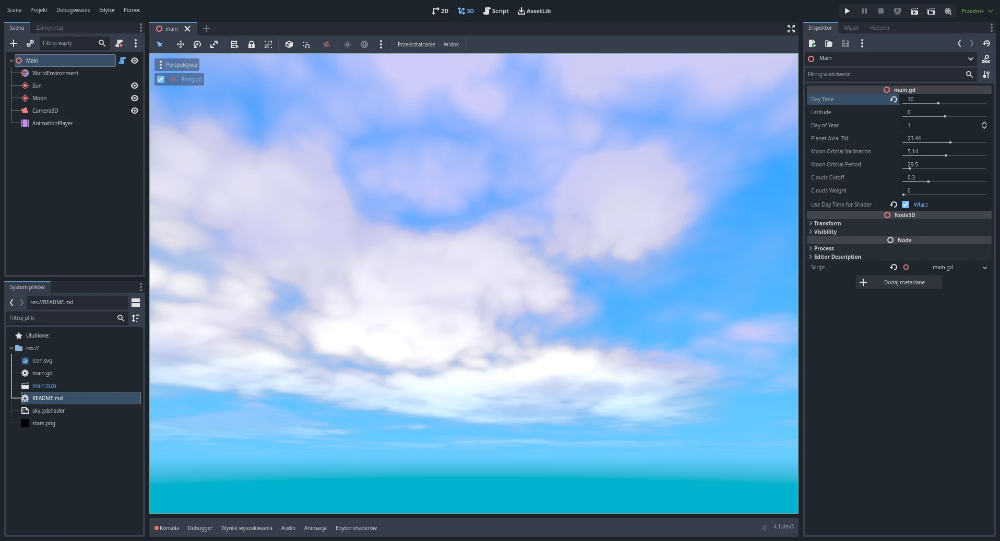
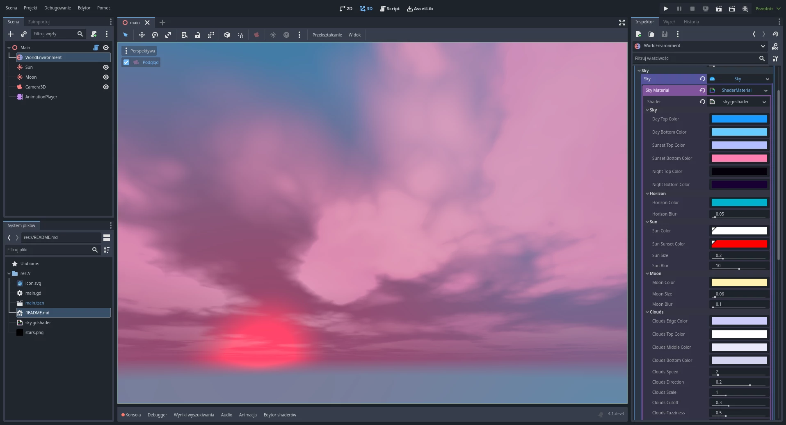
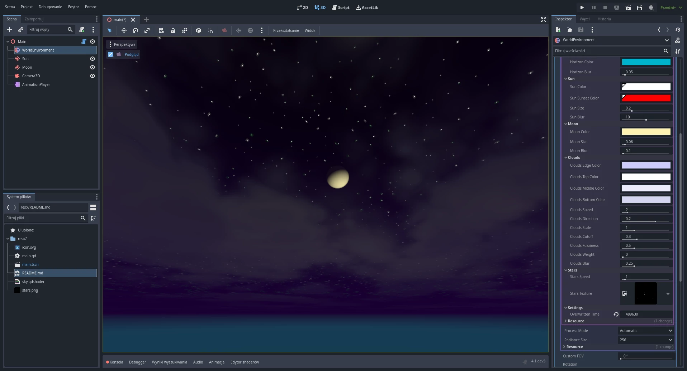

# SIMbiogenesis — renewable energy simulator (Godot 4.6)

First-person simulator with real weather, terrain from GPS, solar/wind/hydro physics, and Home Assistant digital-twin bridge. **Godot 4.6**, Forward Plus.

**GitHub lite clone:** bespoke SOAK/Mars art is not in Git — see [ASSETS.md](ASSETS.md). Generated location maps work without the asset pack.

---

A simple Godot 4 project with day-night and season systems, a procedurally moving sun and moon, and a stylized sky shader.

Features:

- Extremely simplified day-night system with support for seasons based on latitude and earth axial tilt
	- Calculated position of the sun and drawing it through the sky shader
	- Shorter days in winter and longer in summer
	- Changing position of the sun depends of the day of the year
- Calculated position of the moon and drawing it through the sky shader
	- Include the inclination of the orbit and the period of time to cover it
- Sky shader
	- Clouds based on noise function (without repeating texture)
	- Phases of the moon depending on the position of the sun

Shader effect on YouTube:

## Map flow (launch hub)

- **Play** from the project opens the **Launch hub** (`scenes/ui/map_select/map_select.tscn`): energy-zone world map, scrollable **Your maps** list, **Create map here**, **Start**, and **Continue** (latest autosave or newest manual slot).
- **While in-game:** **M** opens the location picker overlay (Set location); bottom **Timeline** — **💾** save/load; **🗺** autosaves and returns to the launch hub.
- **Direct map testing (editor):** open `scenes/maps/generated_location.tscn` or your local SOAK/Mars scenes (if present) and run the **current** scene (F6). Old saves referencing legacy paths are rewritten when you Continue / Load.

## Save / load

- **Timeline** (bottom bar): **💾** opens **Save / Load** (eight manual slots, **Continue**, **Delete**, overwrite prompts). **Esc** still opens the legacy time UI as before.
- **Autosave** every **3 minutes** to `user://saves/autosave.save.json` while a **Main** map runs (not in the editor).
- Manual slots: `user://saves/slot_01.save.json` … `slot_08.save.json`.
- Saves include **which map** (`scene_path`) so **Continue** / load can open the correct `Main` scene when it differs from your current one.

**Quick check:** enter a map, move, save slot 1, return to map menu, **Continue** — same map and position. Switch maps, load a slot from the other map — scene should switch and apply the snapshot.

## Beta builds (Phase 6)

- **Godot 4.6** + export templates matching your editor build.
- Presets: **Windows**, **macOS**, **Linux** → `build/SIMbiogenesis.exe`, `build/SIMbiogenesis.app`, `build/SIMbiogenesis.x86_64` (see **`export_presets.cfg`**).
- Maintainer checklist and patron pointers: **[`PHASE6_BETA_READINESS.md`](PHASE6_BETA_READINESS.md)**.
- **macOS:** Set your real **bundle ID** and signing identity before distributing outside quick tests; placeholder in preset is `com.simbio.genesis.beta`.
- **Secrets / HA:** still **`user://`** only — **[`LOCAL_CONFIG.md`](LOCAL_CONFIG.md)**.

## Secrets and integrations (GitHub / collaboration)

Home Assistant, UISP, and other user-specific settings are stored under Godot’s `user://` path at runtime — **never commit** real tokens or URLs copied from your machine into this repo.

Templates with placeholders: [`config-templates/`](config-templates/README.md). Full reference: [`LOCAL_CONFIG.md`](LOCAL_CONFIG.md).

## Assets and lite GitHub clone

Maps depend on large `res://` art (see **[`PHASE3_ASSET_PACK.md`](PHASE3_ASSET_PACK.md)**): use a **Patreon/private asset zip** merged at the project root, or commit everything / Git LFS. The project does **not** yet open `scenes/maps/mars_aerial.tscn` with zero art installed.

## Cleanup roadmap

- Autoload scripts and save helpers live under **`core/`** (Phase 0–2 restructure). Map scenes: **`scenes/maps/mars_aerial.tscn`**, **`scenes/maps/soak_festival_2026.tscn`**. Shared HUD and world prefabs: **`scenes/ui/`**, **`scenes/gameplay/`** (Phase 4 restructure).
- [`PHASE1_INVENTORY.md`](PHASE1_INVENTORY.md) — inventory, repo hygiene notes, completed Phase 2/3 log.
- [`PHASE3_ASSET_PACK.md`](PHASE3_ASSET_PACK.md) — lite repo vs Patreon/private asset pack workflow.
- [`PHASE4_MODULE_DESIGN.md`](PHASE4_MODULE_DESIGN.md) — module boundaries; `GameplayRules` + `ScenarioConfig` are implemented (see `gameplay/`, `scenarios/`).
- [`PHASE5_SCENE_SHELL_DESIGN.md`](PHASE5_SCENE_SHELL_DESIGN.md) — scene-shell/map-select design and risk review.
- [`PHASE6_BETA_READINESS.md`](PHASE6_BETA_READINESS.md) — Patreon beta / exports checklist; Phase 7 perf preview.
- [`PHASE7_PERFORMANCE.md`](PHASE7_PERFORMANCE.md) — profiler workflow, soak matrix, Phase 7 code pass notes.
