# SIMbiogenesis — feature tour

A short visual tour of what the game can do today, one section per mode or feature, with how to open it. Every image is a screenshot from the automated feature tour (`tools\tour.ps1`), taken on the author's real sites.

**Contents** — [World](#world) · [Build](#build) · [Systems](#systems) · [People](#people) · [Labs](#labs)

## World

*The real place: terrain, imagery, sky, time and weather.*

### Any place on Earth

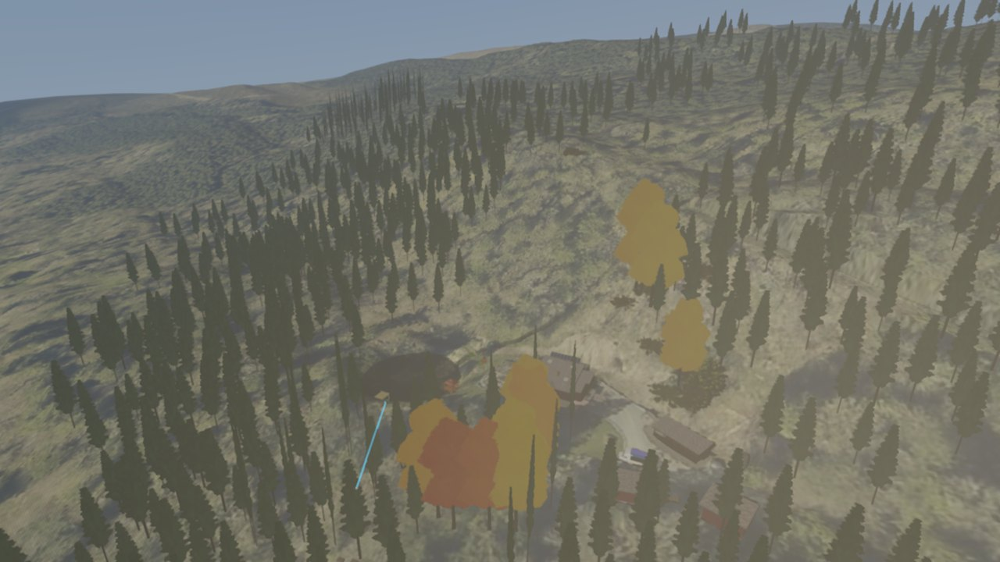

*Real terrain, aerial imagery and OpenStreetMap buildings for the site you pick.*

**How to open:** **Click Play → pick a world**

- Pick or create a world in the launch hub
- Walk with WASD, look with the mouse

Every world stands on a real map: an elevation model, aerial imagery draped at up to native county resolution, and the buildings, roads, water and forests from OpenStreetMap. The sun, sky and weather follow the site's real latitude, date and archived weather.

### Survey drone

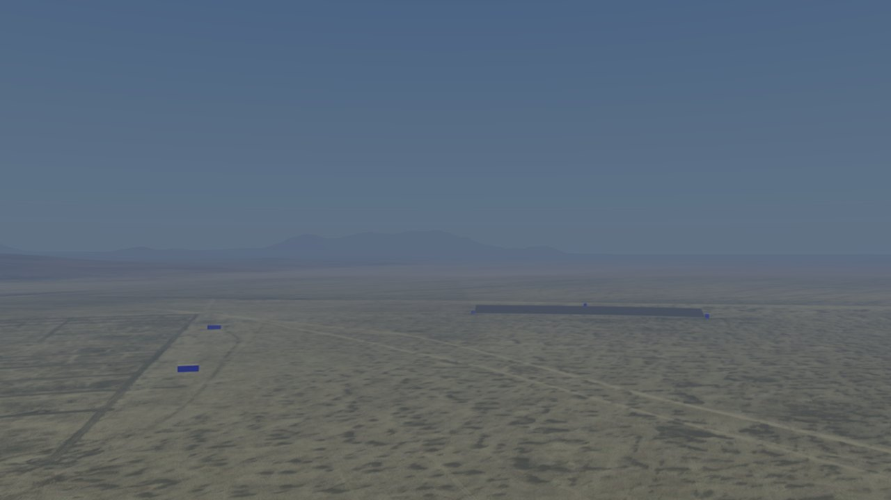

*Take off from where you stand and fly the site.*

**How to open:** **Press Tab**

- Press Tab to take off from your current view
- WASD to fly, Space / Ctrl to climb and descend, Tab or X to land

The drone lifts off from the player's own camera, so the view starts exactly where you were looking. It is the quickest way to read a site's layout before building on it.

### Third person

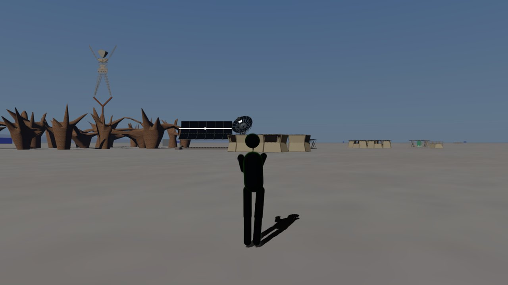

*A follow camera over the shoulder, with a body that walks, runs and drives.*

**How to open:** **Press F5**

- Press F5 to switch between first and third person
- Settings → Player for distance, shoulder and body

Third person keeps every tool working: the crosshair, interaction and vehicles all read the same camera. The player's figure is posed procedurally for walking, running, jumping, driving and using tools.

### Time, sun and sky

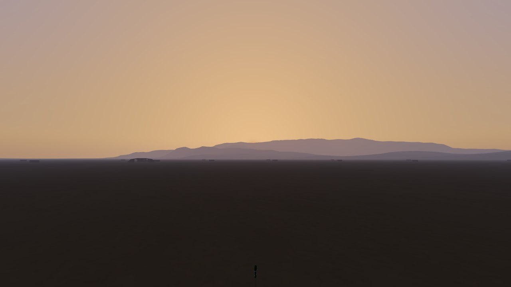

*Scrub the clock: the real sun path, sunsets and twilight for the site's date.*

**How to open:** **Click the timeline**

- Drag the timeline at the bottom of the screen
- Space plays and pauses; the speed buttons run time faster

The clock is reversible: sun, moon, sky, weather and even the battery scrub backwards along exactly the curve they followed forwards. The sunlight, skylight and colour all come from one daylight model, so a sunrise fades in instead of switching on.

### The real night sky

*Stars, planets and the moon where they really are for this site and date.*

**How to open:** **Press Home**

- Scrub the timeline to night
- Press Home to show the reference-star markers
- The ∞ speed preset turns on analemma mode (stars through daylight)

The star field is a registered Stellarium map turned by the computed sidereal time for the site's latitude, so constellations rise and set where they do outside. Planets, the moon's phase, an optional zodiac overlay and analemma planet paths all come from the same astronomy code.

### Planets

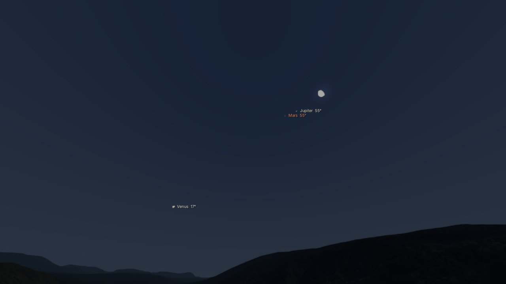

*Mercury to Saturn where they really are tonight, with name tags.*

**How to open:** **Click Settings → Planets**

- Scrub the timeline to night
- Settings → Planets: name tags (off / when you look at one / always), colours, sizes

Each planet's position is solved from its orbital elements (JPL's Keplerian set) for the clock's own instant and drawn into the sky shader as a point of light. Name tags can follow the view or stay on, and the same solve draws the planets' paths in analemma mode.

### Moon phases

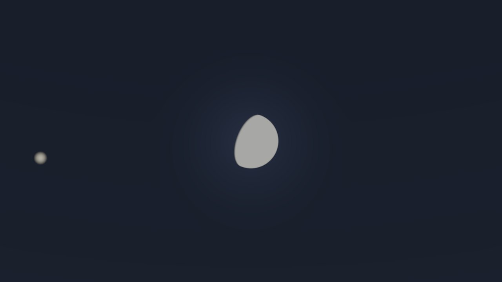

*The real moon: where it stands and how much of it is lit, for any date.*

**How to open:** **Click the timeline**

- Scrub the timeline across a month
- Settings → Sky: moon size and phase offset

The moon's position comes from Meeus's lunar theory with topocentric parallax, and its lit fraction from the real angle between the sun and the moon, so crescents, quarters and the full moon rise, transit and set on the dates and at the bearings they do outside.

### Analemma mode

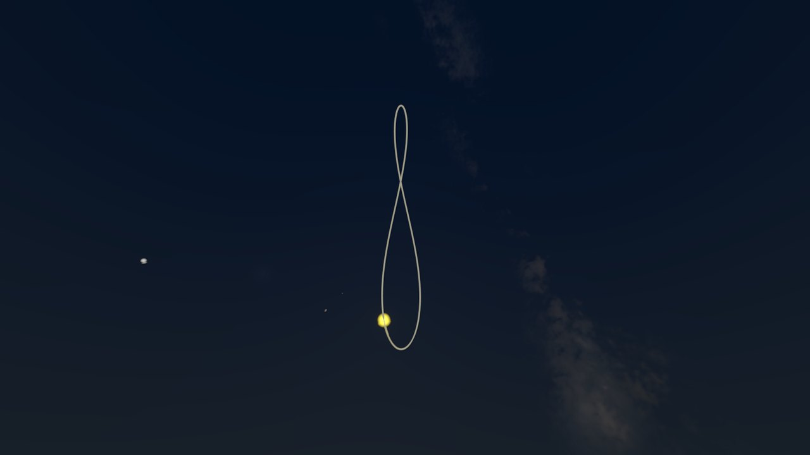

*A day per frame at solar noon: the sun's figure-eight, a year of leaves, the planets and the moon.*

**How to open:** **Click ∞ on the timeline speed control**

- Click the timeline's faster button past the top speed to the ∞ preset
- Space plays; ∞×2 steps two days a frame
- Settings → Sky: solar or lunar analemma, sun / moon / planet paths, stars through daylight

The ∞ preset steps the calendar one day per frame to the site's mean solar noon, so the sun traces the analemma for the real latitude while years go by and the forest runs through its seasons — leaf-out, autumn colour and leaf drop — at the same pace. The stars stay visible through daylight, the planets' paths are sampled at the same instants (Mercury and Venus loop round the sun's figure-eight), and the lunar mode catches the moon at each transit to draw its own analemma.

### Weather and extreme events

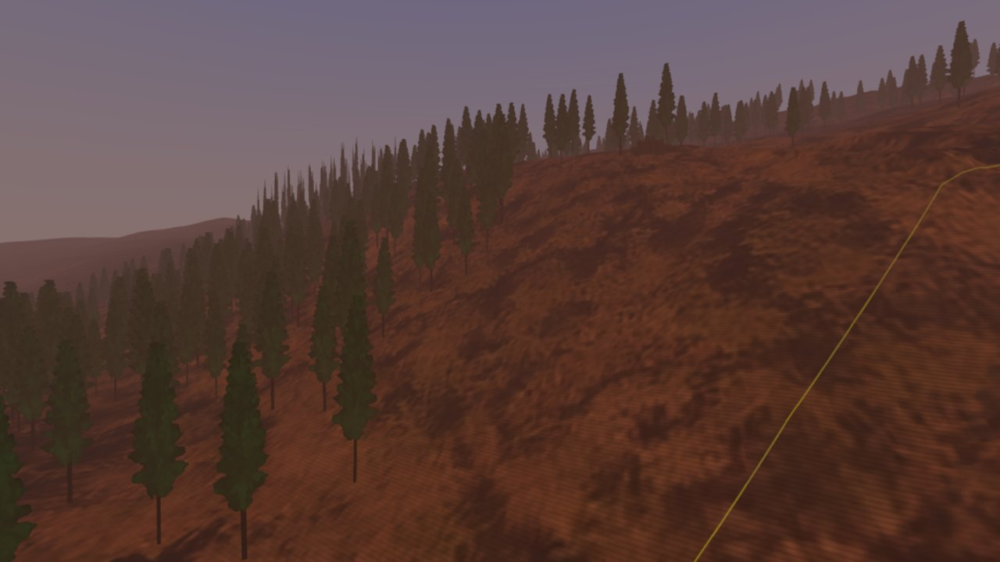

*Archived and forecast weather drive the sky; smoke, dust and heat can be simulated.*

**How to open:** **Click ⚙ → Extreme Weather**

- Weather follows Open-Meteo automatically (the 🌤 / 🌎 indicator)
- Settings ⚙ → Extreme Weather → Preview a hazard
- 🌫 on the timeline calibrates local fog and wind

Clouds, wind, temperature and rain come from the real hourly record for the site, so solar output and the look of the day match what happened. Wildfire smoke, dust storms, damaging wind and heatwaves are resolved from alert and air-quality data — and can be previewed on demand.

### Choose a location

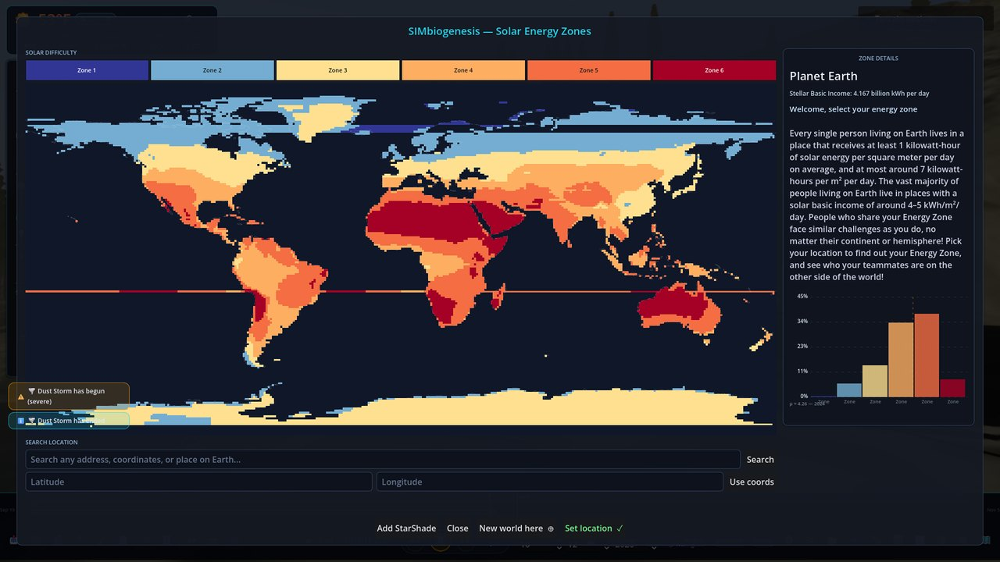

*A world map with solar resource data — click anywhere to build a site there.*

**How to open:** **Press L**

- Press L for the location picker
- Click the map, search an address or type coordinates
- "Create map here" builds a new world on that spot

The picker shows the NASA POWER solar-irradiance grid over a world map. Any coordinate becomes a playable map: elevation, imagery and OSM content are fetched and cached for it, and the world's sun and weather follow it.

## Build

*Shape the site and put things on it.*

### Terrain sculpting

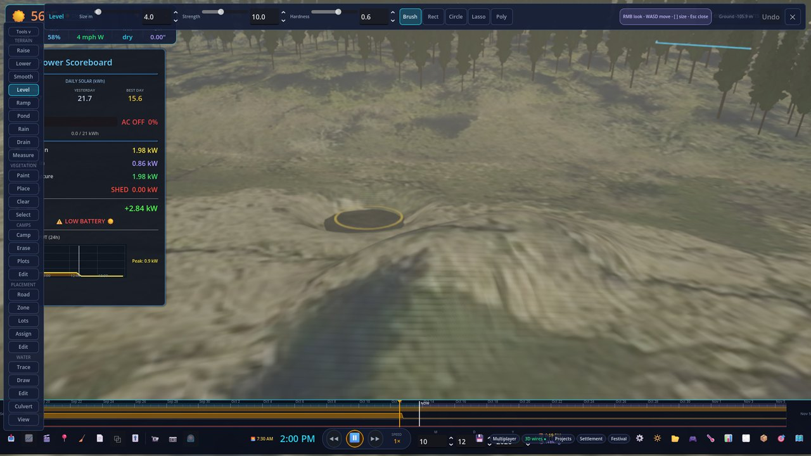

*Raise, lower, smooth, level pads, cut ramps and dig ponds at 1.5 m resolution.*

**How to open:** **Press T**

- Press T for the edit toolbar's terrain tools
- Pick Raise / Lower / Smooth / Level / Ramp / Pond on the left strip
- Each tool keeps its own radius, strength and shape

Edits are sparse height tiles over the real DEM, drawn as their own hi-res meshes with colliders, with region-scoped undo. The toolbar is a tool overlay, not a modal: you keep walking and looking while you sculpt.

### Forests, seasons and growth

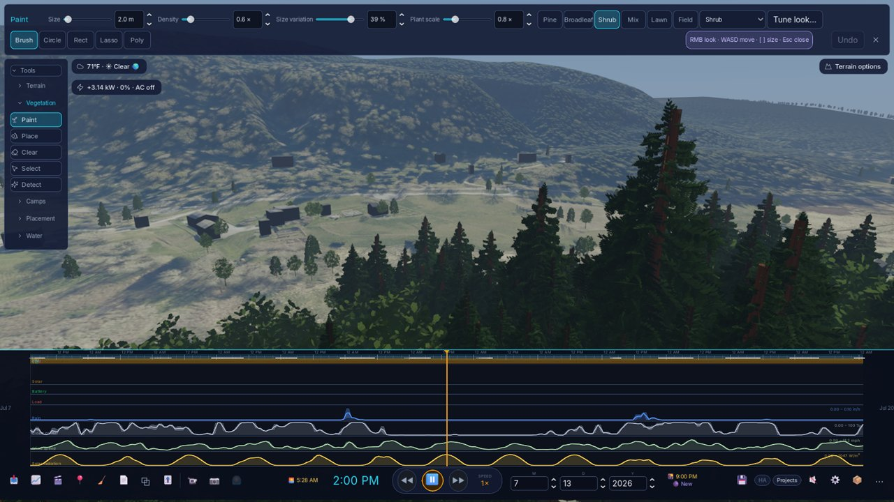

*OSM forests become real trees that change with the seasons; paint your own.*

**How to open:** **Press V**

- Press V for the vegetation tools (Paint / Place / Clear / Select)
- Tune look… edits a species with a live preview
- Aim at a forest area and Interact to fill it with a chosen species

Mapped woods, tree rows and hedges are scattered with species picked for the site's climate. Trees leaf out, colour and drop their leaves with the real latitude and date, grow on a calendar-driven life cycle, and fade to baked impostors in the distance.

### Painted camps

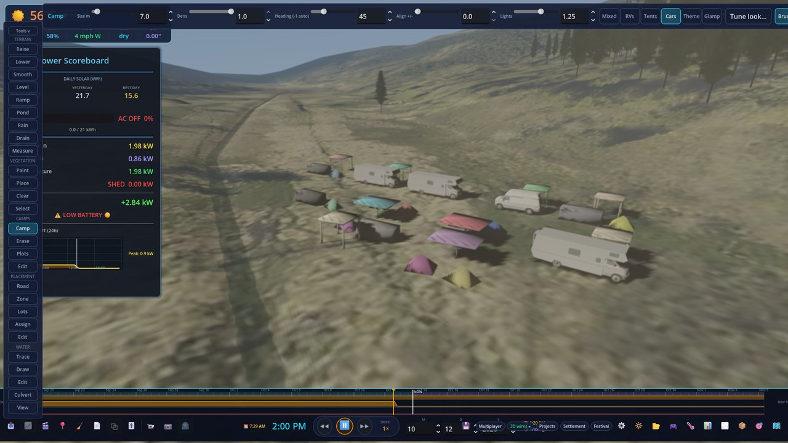

*Paint where people camp and the area fills with tents, shade and vehicles.*

**How to open:** **Press C**

- Press C for the camp tools
- Camp: brush, rectangle, lasso or polygon; Erase; Plots; Edit
- Tune look… authors a camp style and its layouts

Camps are households on a world-anchored lattice — an RV with its awning and car, tents round a canopy — kept clear of buildings, roads, water and steep ground. Painting a camp bigger adds households without moving any already standing.

### Streams and drainage

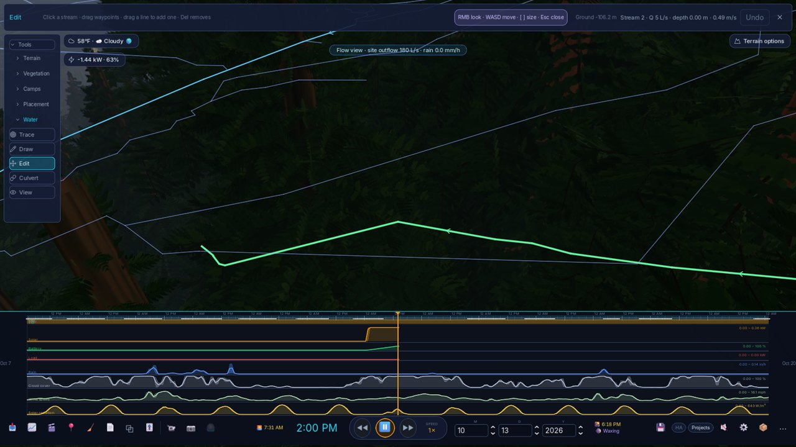

*Mapped streams carved into the land, with real flow, drainage and culverts.*

**How to open:** **Press T** · **Click WATER section**

- Open the edit toolbar (T) and pick the WATER section
- Trace / Draw / Edit / Culvert / View tools
- View → flow shows the water moving at its Manning velocity

OSM waterways and the player's own streams are one network: carved into the terrain, drawn level in their channels, sized by real hydraulics, and fed by rain on their catchments at the clock's time. A stream can feed a turbine's penstock or a pond on the systems graph.

### Placed things and the prop editor

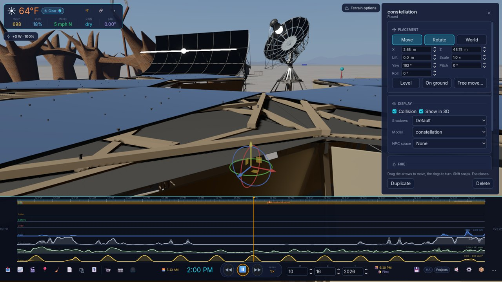

*Place real equipment from the library and move it with a gumball.*

**How to open:** **Press U**

- Press U for the library and place a model
- Click a placed thing to open its editor: move / rotate gizmo, fire, model tools
- M toggles placed-props mode

Turbines, shade structures, tanks, vehicles and imported models are placed in the world and bound to their nodes on the systems graph. One editor handles every placed thing: a world/local gumball, duplicate and delete, and the model's own tools.

### Building builder

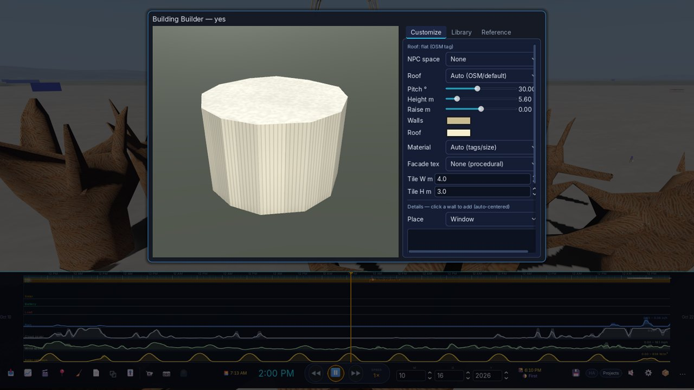

*Restyle any OSM building: roof shape and pitch, walls, doors, windows, facades.*

**How to open:** **Press B**

- Aim at a building and press B (or Interact)
- Click the preview walls to place doors and windows
- The Library tab swaps the building for a placed model

OSM footprints become buildings with level eaves and real roof geometry (gable, hip, pyramid) from their tags, roofs textured from the aerial photo. Each building can be restyled in a studio preview and the change is saved per site.

### Light Studio

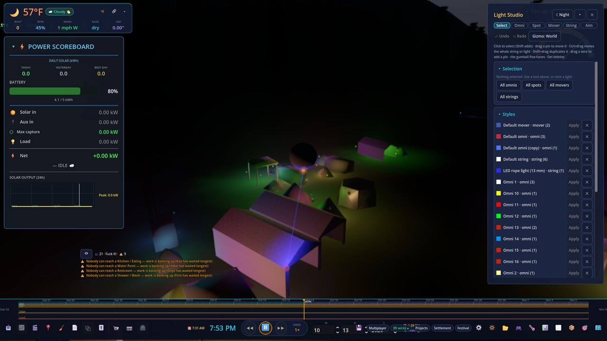

*Place lamps, spots, string lights, neon and moving heads; animate them.*

**How to open:** **Press J**

- Press J for the Light Studio dock
- Omni / Spot / String tools; drag the gumball to move
- Linked styles restyle every light that shares them

Lights are placed on surfaces, strung between pins or hung as moving fixtures with programmed sweeps. Strings run LED chases on the GPU in step with real lights, and any light can react to the music at a stage.

### Vehicles

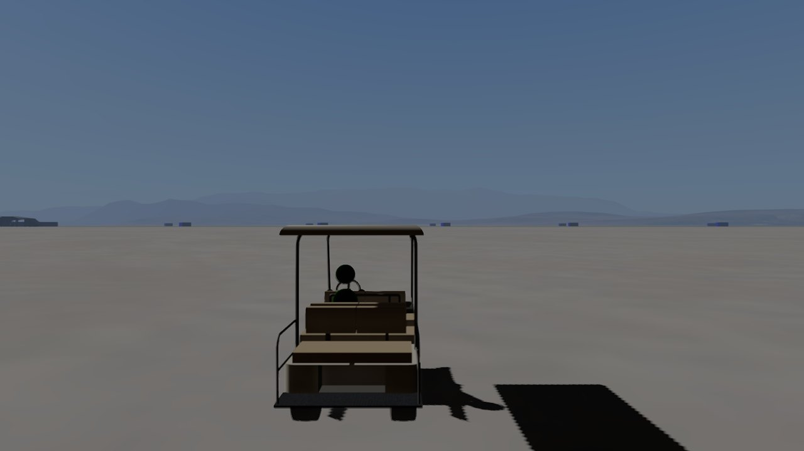

*Place a golf cart, EUC, skid steer, camper van or tool bus — and drive it.*

**How to open:** **Press O** · **Click Library → Vehicles**

- Library (U) → Vehicles tab → place one
- Aim at it and Interact to get in; X to get out
- F5 for the chase camera

Placed vehicles use the same riding code as the scene vehicles, with a real collision footprint, a chase camera in third person, and an electric battery that drains with distance and trickle-charges while parked.

### Parametric hardware store

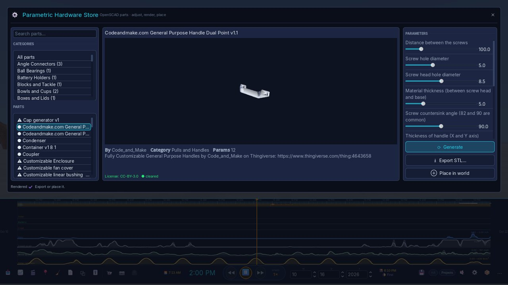

*Customise OpenSCAD parts, render them to STL and place them in the world.*

**How to open:** **Press H**

- Press H for the store
- Pick a part, adjust its parameters, render, place

A catalogue of licence-checked OpenSCAD designs with their Customizer parameters exposed as controls. Parts render through headless OpenSCAD to STL meshes that can be placed like any other model.

### Mud printer

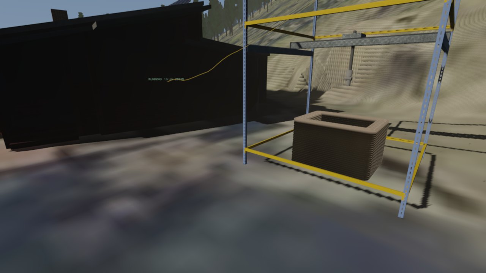

*A gantry printer for mud and clay: design a building, slice it, and watch it print.*

**How to open:** **Press U**

- Press U for the library → Tools → Mud Printer, and place it
- Aim at the printer + Interact: the 3D print setup
- Design building… draws rooms, walls and doorways; Print starts the job, Export GRBL writes the G-code

Additive machines are placed in the world and bound to a node on the systems graph. The print setup previews a part on the bed with its toolpath layer by layer; the building designer turns a floor plan into cambered, infilled walls and exports volumetric GRBL G-code. A started print rises bead by bead in the world on the sim clock — scrub the timeline and it builds or un-builds — and dries from wet to dry colour in place.

### Pallet rack builder

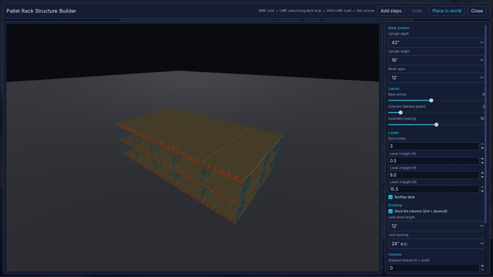

*Design warehouse racking — bays, levels, stepped and U layouts — and place it.*

**How to open:** **Press P**

- Press the pallet-rack key, or Library → Structures → Pallet Rack
- Change bays, columns, levels and beams; click parts in the preview to edit them
- Place in world; click a placed rack → Edit rack… to change it in place

A parametric racking designer with real upright, beam and decking sizes. Layouts can be stepped or U-shaped, single parts can be picked and changed in the preview, and the finished rack is placed as one prop with collision, a packed shipping size and an NPC space tag.

### Flat-pack furniture

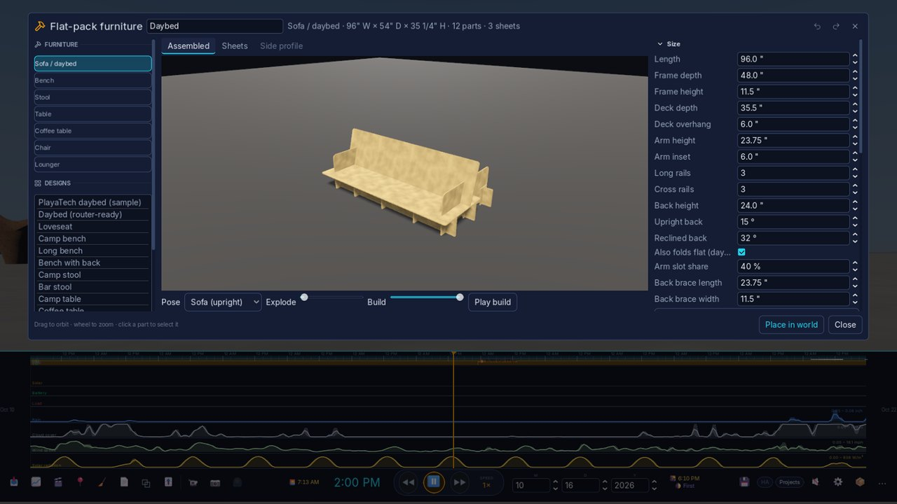

*Design slotted plywood furniture, see it nested on 4×8 sheets, and export DXF / SVG cut files.*

**How to open:** **Click Flat-pack furniture designer…**

- Library → Structures → Flat-pack furniture designer…
- Pick a sofa, bench, stool, table, chair or lounger, or one of the built-in designs
- Change the sizes, the plywood, the bit and the joinery; every slot is worked out from the assembly
- Sheets shows the parts nested as they will be cut; Export DXF + SVG writes the files
- Place in world: people sit on benches and sleep on the daybed

A parametric designer for the slot-together plywood furniture seen all over Burning Man. Each piece is a set of flat parts; the designer intersects them in 3D and cuts the half-lap slots, mortises and wedge holes where they meet, sized to the plywood's real thickness plus clearance, with dogbones for the router bit. The parts nest onto sheets, the cut list gives every size, and one DXF and SVG per sheet goes straight to a CNC. The sample sofa sets up upright, reclined or flat as a daybed from the same twelve parts.

### Dome & zome designer

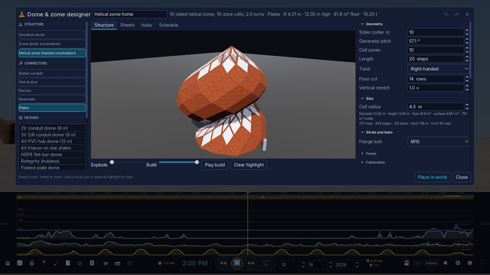

*Design geodesic domes, zomes and helix zomes in conduit, hubs, flat bars, rotegrity slats or folded plates; get the strut schedule, hub templates and cut files.*

**How to open:** **Click Dome & zome designer…**

- Library → Structures → Dome & zome designer…
- Pick Geodesic or Zome, a connector system, or a built-in design
- Set the class, frequency, truncation, radius, the strut stock, the hubs and the covering
- Parts lists every strut, hub and panel type; the schedule carries chord factors, cut lengths, bends and hub arm angles
- Export writes DXF / SVG per sheet and hub template, the strut and BOM CSVs and the whole design as JSON
- Place in world: a dome people can shelter under, which packs to its strut bundle

A parametric designer for nearly any dome: Class I, II and III geodesic subdivisions of the icosahedron, octahedron and tetrahedron, truncated at any ring and stretched into ellipsoids; polar-zonohedron zomes of any order; and the helix zome, the zonohedron's smooth limit built from continuous curved ribs. Five ways to join them — flattened conduit on a bolt, rigid struts into socket or star-plate hubs, flat bars bent to the curve, hubless rotegrity slats, or folded plates with no struts at all — each worked out from the geometry alone: dips, bends, hub arm patterns, arc lengths, flange folds. The chord factors match the published tables, the bill of materials counts stock lengths and bolts, and the files go straight to a saw, a drill press or a CNC.

### CNC gantry designer

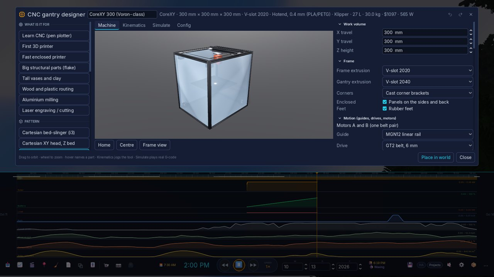

*Design a 3D printer, router, laser or plotter from V-slot extrusion: seven kinematics, real parts, the motor maths, G-code played at true speed, a priced BOM and a Klipper / Marlin / grbl config.*

**How to open:** **Click CNC gantry designer…**

- Library → Structures → CNC gantry designer…
- Pick what it is for, or a pattern (bed-slinger, Cartesian XY, CoreXY, CoreXZ, H-bot, delta, router) or a built-in machine
- Size the work volume; choose the extrusion, guides, drives, motors, board, tool and bed
- Kinematics: jog the tool and read what each motor does (A = X + Y on a CoreXY)
- Simulate: a sample program or your own .gcode plays through the planner at real speed; send it to the placed machine
- Checks: step rate, torque, belt stretch, gantry sag, screw whip, delta reach; Files: printer.cfg, Configuration.h, grbl $, BOM, cut list

A parametric designer for CNC gantries in the OpenBuilds / RepRap vocabulary: V-slot 2020 to C-Beam, V-wheels or linear rails, GT2 belts, lead and ball screws, NEMA 17 to 34, the boards from RAMPS to Klipper, hotends, pellet and clay extruders, spindles and lasers. Seven kinematic patterns each with their reasons, and the maths behind them made visible: jog the tool and watch the CoreXY motors turn against each other, the delta carriages climb their towers. Real G-code — a calibration cube, a spiral vase, a router pocket, your own file — runs through a trapezoid motion planner at true speed, with every corner slow-down, so the machine's limits can be seen before it is built. The checks are the engineering: step rate against the board, torque against the moving mass, belt stretch, gantry sag, screw whip, delta reach. The bill of materials prices every part and packs the cut list into stock lengths; the exported printer.cfg, Configuration.h and grbl settings carry the same numbers the simulation ran on. Placed in the world, the machine runs the job on the site's clock, drawing filament, flake or clay and power on the systems graph.

## Systems

*The resource-flow graph and the tools that design it.*

### The systems graph

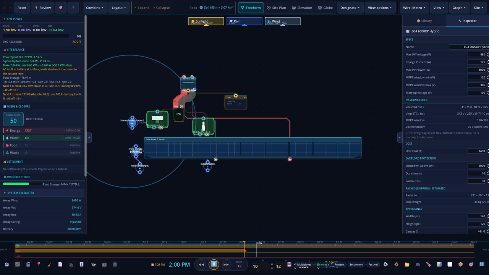

*Every panel, battery, tank, turbine and habitat as nodes, with power and water flowing.*

**How to open:** **Press G**

- Press G to open the graph
- Drag parts from the library on the left; wire ports together
- Click a node for its inspector; Ctrl+G groups into a super-node

The graph is the core game surface: a schematic of the resource flows on the site. Solar strings are checked against the controller's voltage window, batteries form real series/parallel banks, water moves through tanks, ponds and turbines, and it all keeps simulating with the graph closed.

### Graph tools: Tidy and show-only views

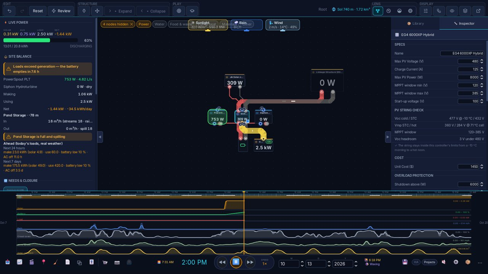

*Lay the graph out in one click, then show only the power, or only the water.*

**How to open:** **Press G**

- Press G, then Layout ▾ → Tidy (Live keeps it laid out as you edit)
- Show ▾ → Power / Water / Food & waste / Fuel & heat, or tick your own
- Library → In the world: what is built but not on the graph yet

Tidy is a force layout whose direction comes from the ports — inputs on top, outputs below — so sources settle above controllers above storage above loads, solar arrays move as one block, and pinned nodes stay put. Show-only views hide every node and wire outside the chosen kinds of flow without removing anything, and the library's In the world drawer lists what is placed on the site but not yet on the graph.

### Site Plan lens

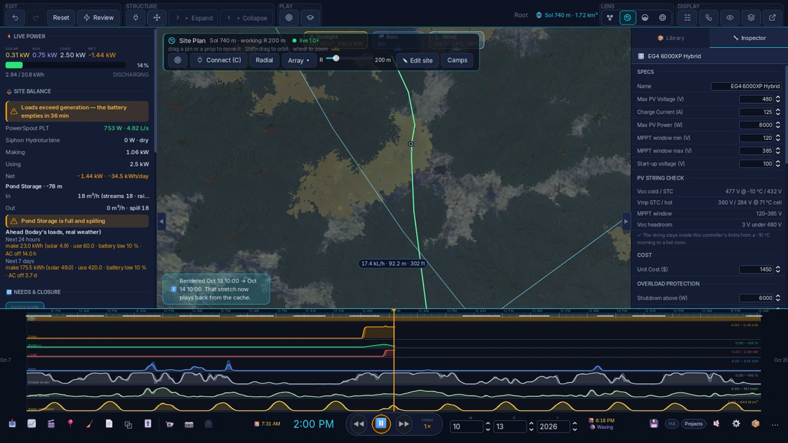

*The same graph laid out on the real site, seen through a live 3D camera.*

**How to open:** **Press G** · **Click Site Plan lens**

- In the graph (G), click the Site Plan lens chip
- Drag empty canvas to orbit, wheel to zoom; drag a pin to move the thing in 3D

Site Plan puts every placed item where it stands in the world, as pins over a live render of the site within its Sphere of Influence. Moving a pin moves the real object, and wires, streams, tagged spaces and people are drawn on the ground.

### Elevation lens

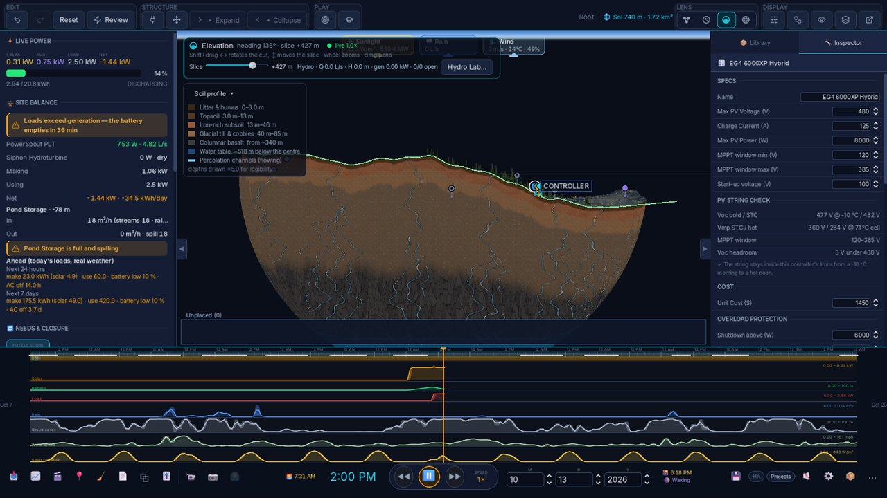

*A cut through the ground: heads, pipes, ponds and the soil profile in section.*

**How to open:** **Press G** · **Click Elevation lens**

- In the graph (G), click the Elevation lens chip
- Hover the cut face to read the soil horizon and the water table

Elevation slices the Sphere of Influence like a cutaway: the terrain profile, buried pipes and every item at its true height, over a solid cut face painted with a Pacific-Northwest soil profile down to the water table. It is where hydro head is read and designed.

### Globe lens

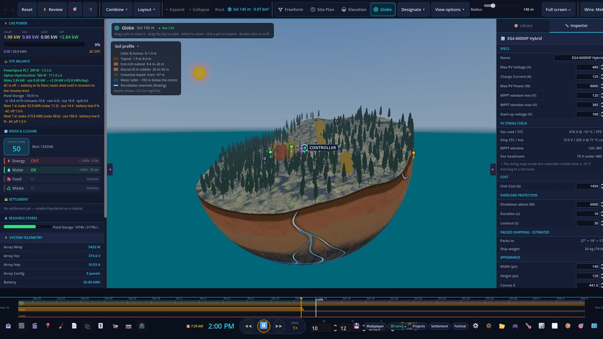

*The Sphere of Influence as a snowglobe you orbit inside the graph.*

**How to open:** **Press G** · **Click Globe lens**

- In the graph (G), click the Globe lens chip
- Drag to orbit, wheel to zoom, double-click to re-fit

The Globe lens frames the site's Sphere of Influence — the area the community draws its resources from — as a glass globe with the real sun on its rim and the strata of the ground below. Pins on it are the same items as in every other lens.

### Full-screen globe

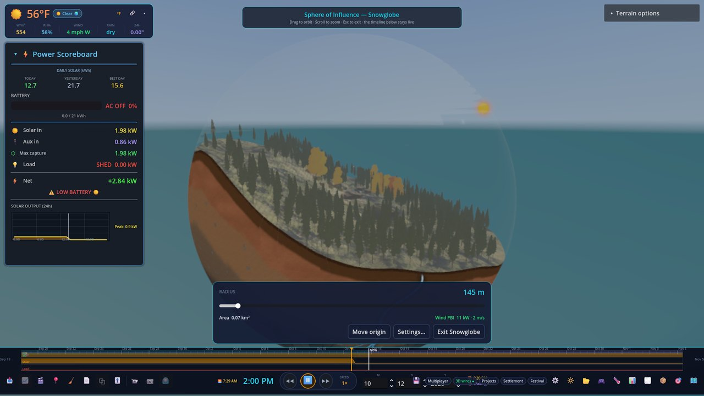

*Step out to the whole site as a globe, full screen, with the clock still running.*

**How to open:** **Click SoI marker / full globe**

- Interact with the SoI marker in the world, or
- the full-globe button on the graph's Globe lens; Esc to return

The full-screen globe renders the real world inside the Sphere of Influence from outside it. No view freezes the clock, so clouds, people and the sun keep moving while you look.

### Hydro Lab

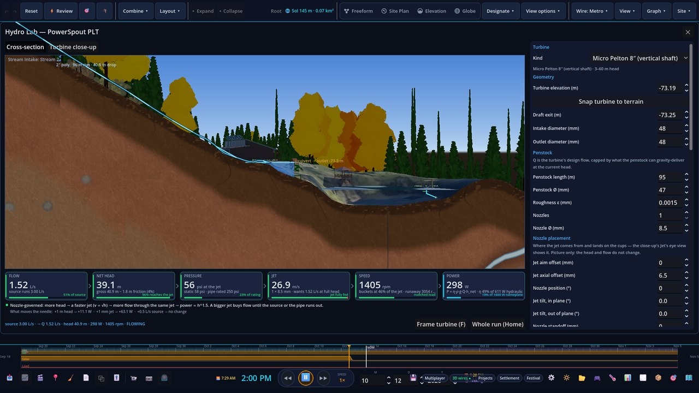

*Design a micro-hydro turbine on its real penstock: head, flow, jet, speed, watts.*

**How to open:** **Click Inspector → Open Hydro Lab**

- In the graph, double-click a hydro turbine (or Inspector → Open Hydro Lab)
- Drag the intake, nozzle and outlet on the cross-section; dial a test flow

The Lab draws the turbine's water path in section over the real ground — pond or stream intake, routed penstock or siphon, the runner and the outlet — and solves it with the same physics the world runs: Darcy–Weisbach losses, Pelton jet and bucket relations, siphon crest limits and cavitation.

### Site Report

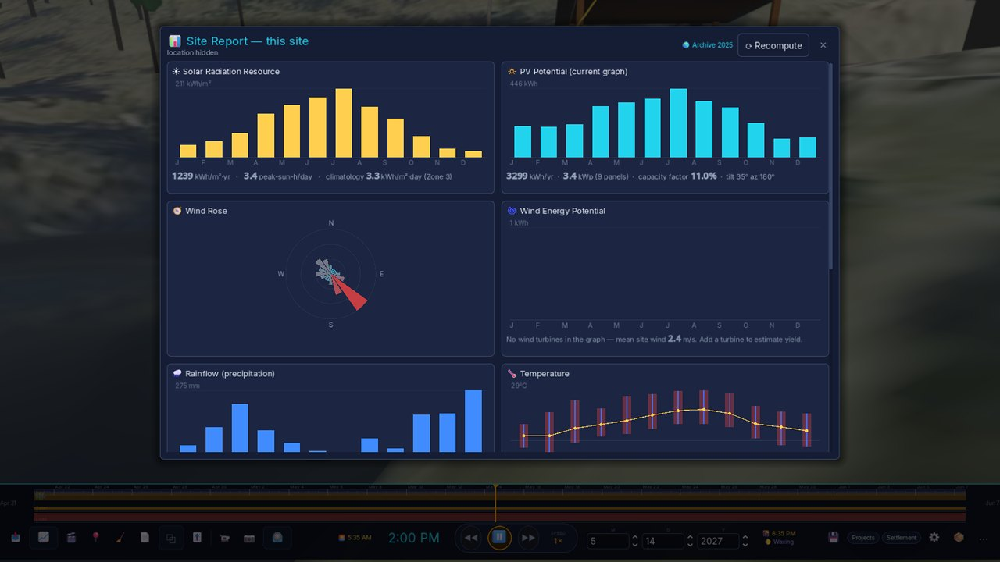

*A month-by-month year of sun, wind, rain, temperature and your system's output.*

**How to open:** **Press K** · **Click 📊**

- Press K, or 📊 on the timeline

The report runs a representative year of the site's real weather through the current graph: solar resource and PV yield, a windrose, rainfall, temperature bands, hydro potential, and what it would take to pack the site into a truck.

### Solar Bootcamp

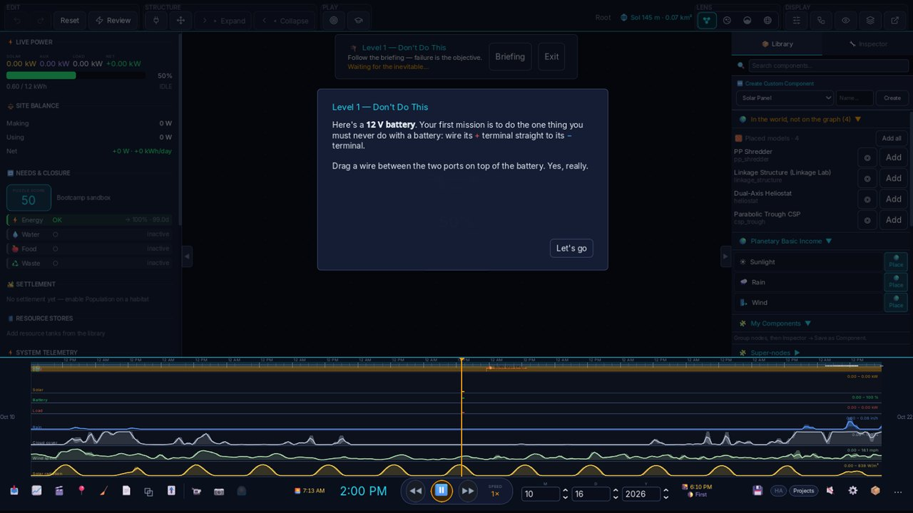

*Twelve short levels that teach DC electrics by letting you blow things up.*

**How to open:** **Click 🎓 Bootcamp**

- In the graph (G), click 🎓 Bootcamp
- Each level runs in a sandbox — your real graph is put back on exit

The tutorial starts with a short circuit and works up through overcharging, PWM vs MPPT limits, series/parallel banks, string sizing and 24-hour runs. Goals are judged on the circuit itself, and run levels on a pre-baked day.

### Challenges

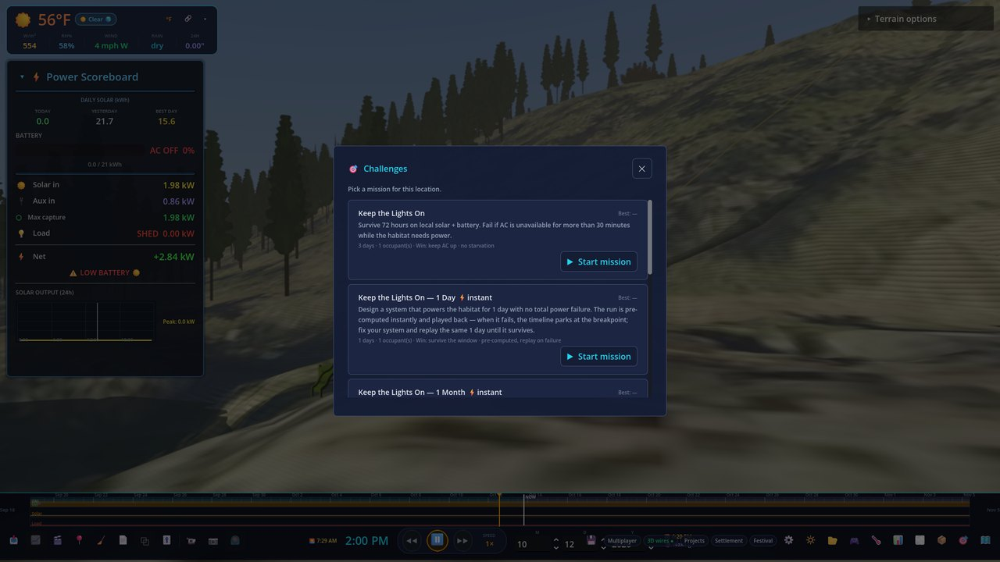

*Keep the lights on through a real day, month or year — computed in seconds.*

**How to open:** **Click 🎯**

- Click 🎯 on the timeline and pick a challenge
- A pre-baked run plays back; retry replays the same days against your edits

Pre-baked challenges simulate the whole span — energy, water and people — before you watch it, then play it back to the moment it failed. Fix the system and retry the same segment to see whether it holds.

### 3D wire and pipe routing

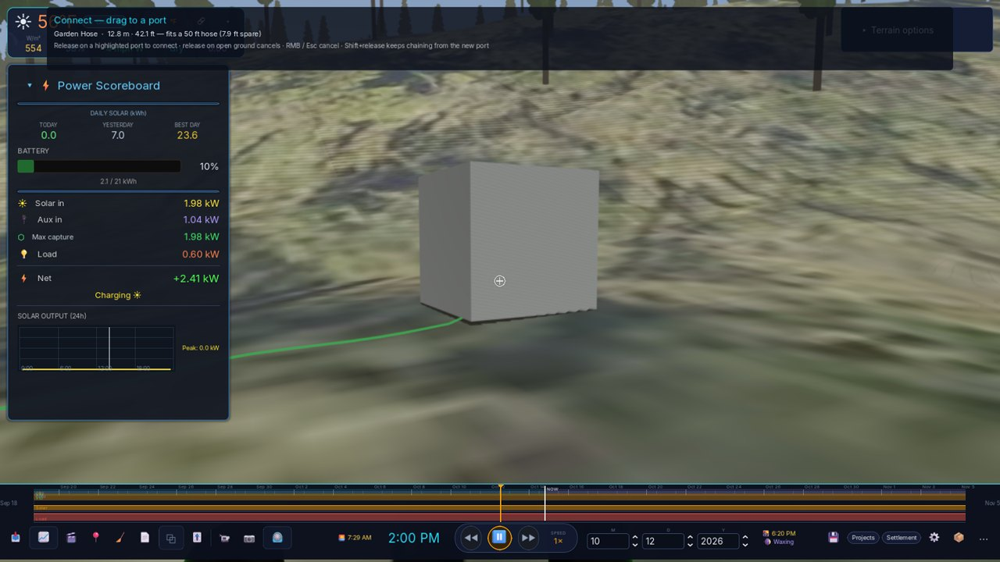

*Pull a cord or a pipe off a device's port and plug it in — measured as you go.*

**How to open:** **Click a device's port (press and drag)**

- Aim at a device's port, press and drag to the other device, release
- Shift+release keeps chaining from the device you plugged into
- Click a run to restyle it live: kind, size, colour — Revert puts it back

Every wire, hose, penstock and culvert on the graph can be a real run in the world, drawn from port to port over the ground and bent round obstacles. The HUD measures the run as it is pulled with the same rule the committed run uses, run-length tags show metres and feet, and the style modal edits the live run with the I²R loss and a stock-length fit in its header.

### Wind turbines

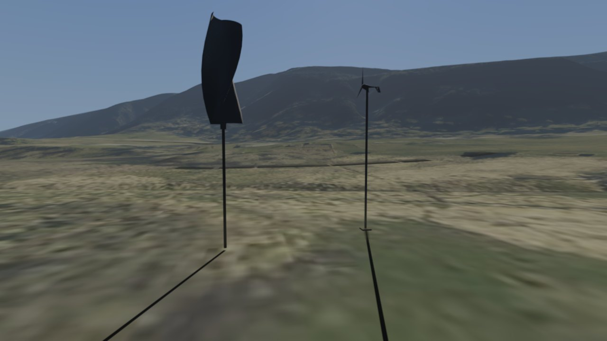

*HAWTs and VAWTs that spin and yaw on the site's real wind and feed the graph.*

**How to open:** **Press U**

- Press U for the library → Wind, and place a turbine
- G shows its node: live wind at hub height and output
- Click a placed turbine to move it or swap its model

Turbine output is P = ½ρAC_p·v³ under the Betz limit, with air density from altitude and temperature and the 10 m wind sheared to hub height. The wind is the site's archived or forecast weather for the clock's hour, the same wind the trees and the dust blow in, and the rotors spin and yaw to it.

### Concentrated solar: troughs and heliostats

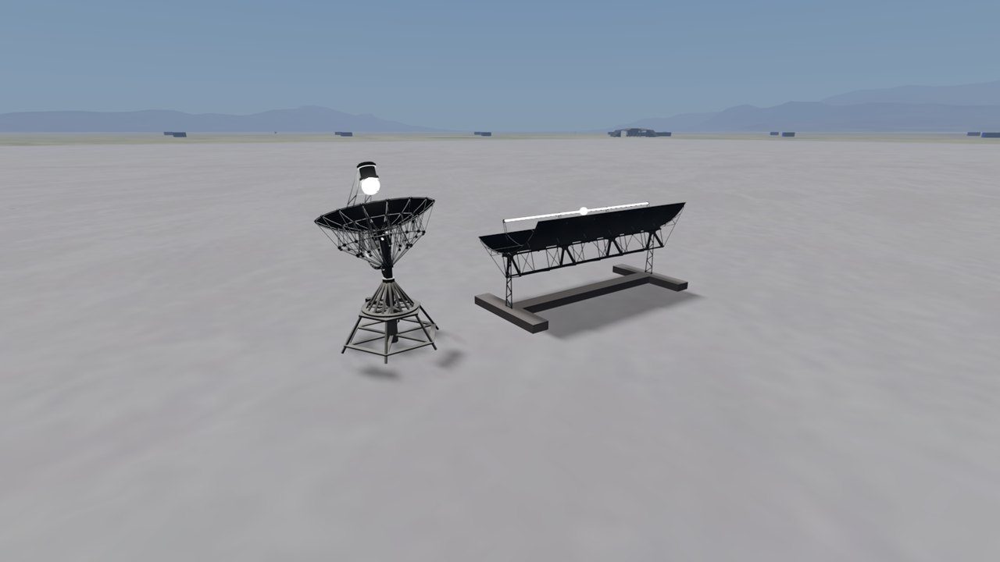

*Mirrors that track the real sun and boil water into steam on the graph.*

**How to open:** **Press U**

- Press U for the library → Solar Concentrators, and place one
- G shows its node: tracking angle, DNI, thermal output, water in → steam out
- Scrub the timeline: the trough tilts and the heliostat turns with the sun

A parabolic trough tilts on a single east–west axis to follow the sun's altitude; a dual-axis heliostat points its whole dish at the sun. Both use the real sun position and the clear-sky or measured direct irradiance, and on the graph they turn water into steam at the rate their optics and receiver allow. The focal line glows with the live concentrated flux.

### Home Assistant live links

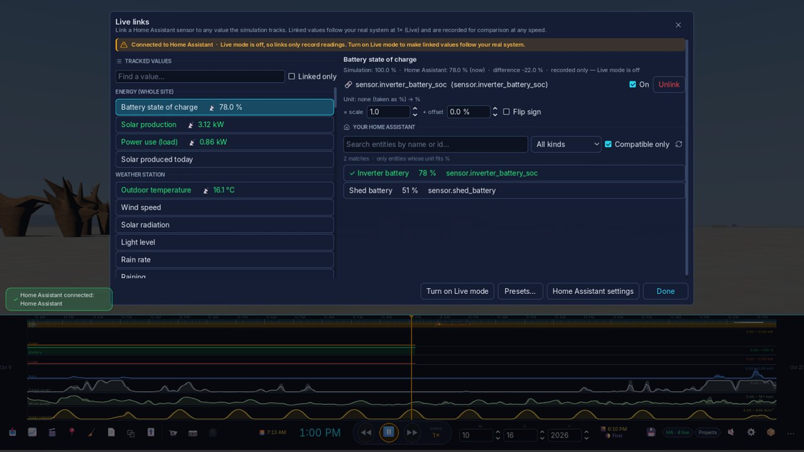

*Connect your Home Assistant and link any sensor to any value the simulation tracks.*

**How to open:** **Click HA**

- Settings → Home Assistant: address + long-lived token → Connect
- Live links: pick a value, click the sensor that measures it
- Turn on Live mode and linked values follow your real system

Type your Home Assistant's address the way a browser shows it and paste a long-lived token; the status card shows each step as it happens and offers the right address when the port is wrong. Live links ties any HA sensor to any value the simulation tracks — the battery, solar, a load, a tank, the weather — with the units converted. In Live mode the simulation follows your real system; at any speed the readings are recorded beside it on the timeline.

## People

*The community that lives there, and the crowd simulation.*

### Festival mode

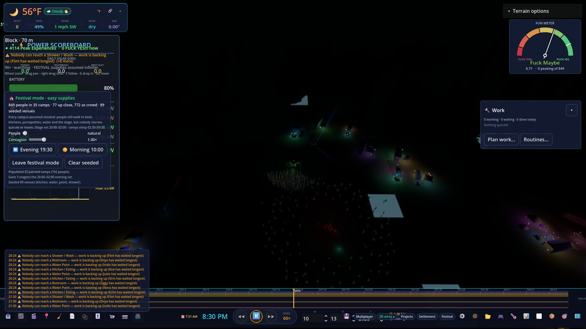

*One button: every painted camp gets people, venues are seeded, and the crowd comes alive.*

**How to open:** **Click Festival**

- Click the Festival chip on the timeline
- The settlement view opens over the camps; Evening / Morning jump the clock
- Leave keeps the camps; Clear seeded removes the venues it added

Festival mode runs the crowd simulation on easy supplies: hundreds of people with needs, friend groups and tastes, living a festival day between their camps, kitchens, portapotties, the bass stage and the temple. Nearby people are full agents; the distant crowd is simulated as events and drawn on the GPU.

### Settlement view

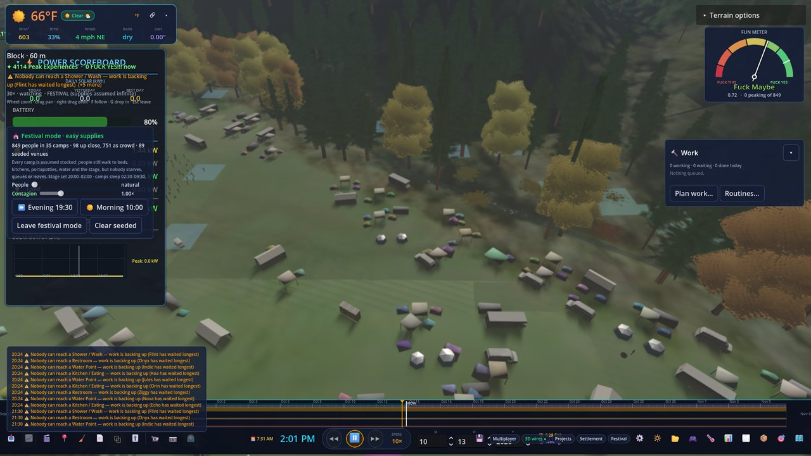

*Watch the community work: one camera from eye level up to the whole site.*

**How to open:** **Click Settlement**

- Click the Settlement chip on the timeline
- Wheel zooms from ground to site, drag pans, click a person to follow them
- The work dock edits priorities and chores without leaving the view

The second play mode: you shape the conditions — spaces, routines, chores, site rules — then watch. There are no orders; people decide for themselves from their needs, morale and the work on the board, and the camera never stops the clock.

### The burn

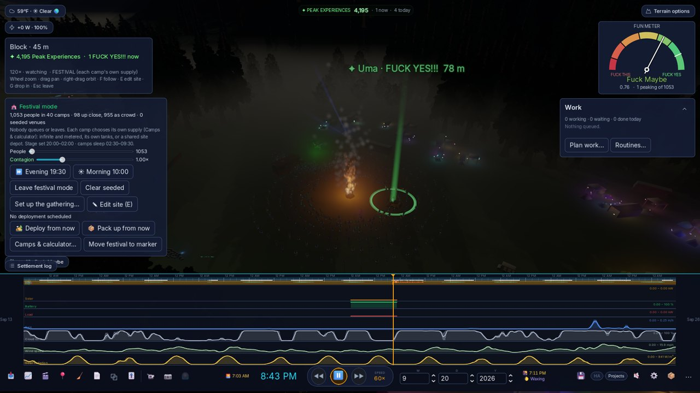

*Light the effigy: the crowd gathers in rings, the fire climbs, it falls, they circle.*

**How to open:** **Click Prop editor → Fire**

- Click a burnable structure → prop editor → Fire → 🔥 Ignite
- Planned climb, bonfire and ember durations can be set before lighting

A fire is a pure function of the clock: it climbs the structure's real surface, collapses into a pile that burns down to embers, and scrubs backwards. At an effigy the crowd forms rings outside a perimeter of height plus ten feet, sandmen hold the line, fire dancers perform, and after the fall everyone circles counter-clockwise.

### StarShade: built by the crew

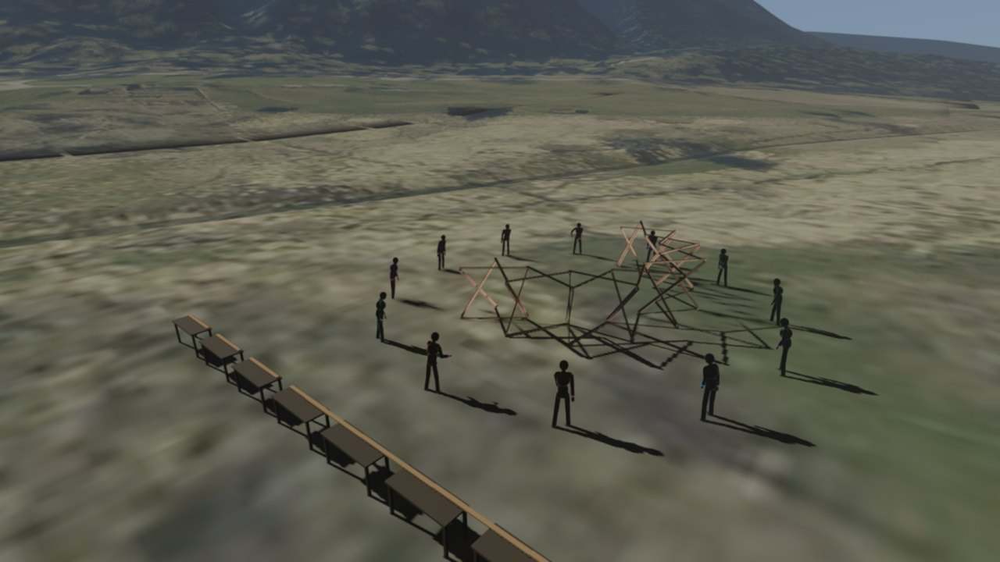

*Twelve people cut, drill, carry, bolt, lift and deploy a StarShade from its real parts.*

**How to open:** **Click Rehearse build (prop editor)**

- Place a StarShade (Linkage Lab → Place in world)
- Click it → Crew → Rehearse build, or queue the build for the camp's crew
- Scrub the timeline: the build runs forwards and backwards with the clock

The build plan comes from the structure's own bill of materials: every beam is cut and drilled at a bench, carried to its seat and placed, every joint fastened, then a raising crew lifts the ring and the fold deploys. Named workers walk between jobs with the tool for each in hand, the structure only grows, and the whole build is a pure function of the clock — scrub it back and it comes apart again. Queued for a camp, the real crew builds it as fast as their credited work allows.

### NPC animation editor

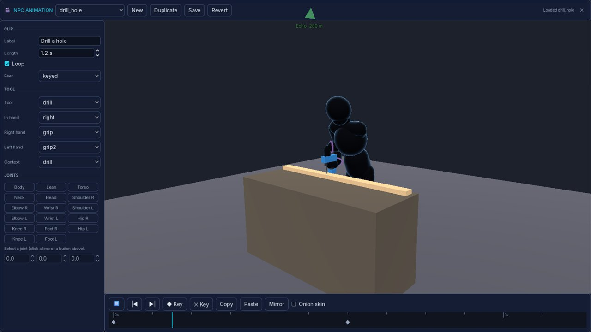

*Key-frame how people saw, drill, lift and carry — with the tool in their hands.*

**How to open:** **Click ⚙ → NPC → Animation editor…**

- Settings ⚙ → NPC → Animation editor…
- Click a joint, drag the gizmo ring, K adds a key, Ctrl+S saves

Fabrication clips are authored on the same stick figure the crews use, in the context of the real job — a saw on its bench, a drill at the hole — with the hands held to the tool's grips by IK. Saved clips are picked up by the build crews at once.

## Labs

*Design studios and multiplayer.*

### Linkage Lab

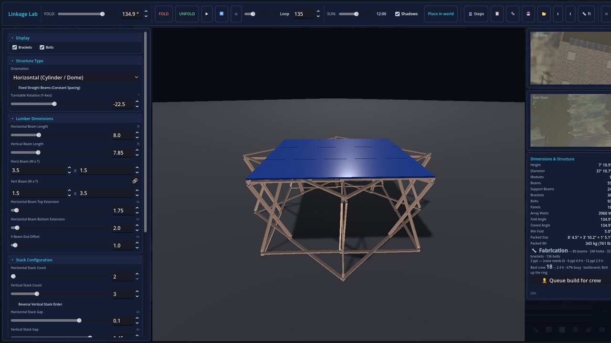

*Design folding scissor-linkage structures — shade, domes, arches — and fold them.*

**How to open:** **Press N**

- Press N for the Linkage Lab
- Fold / Unfold animates the mechanism; 📋 opens the build guide and BOM
- Place in world puts the live, foldable structure on the site

A native port of the LinkageLab designer: compound scissor mechanisms solved in closed form, with solar panels, hardware assemblies, coverings and a full bill of materials, cut list and drill templates. A placed structure folds and deploys in the world and its panels join the solar graph.

### Packing Lab

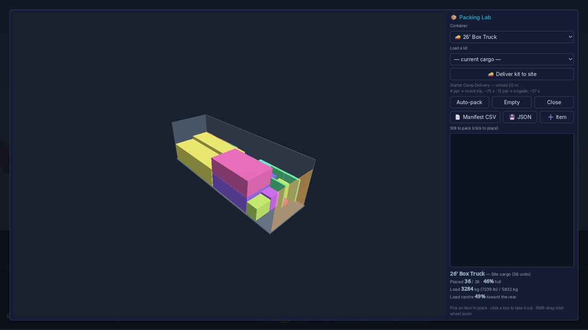

*Will the whole site fit in the truck? Auto-pack it into real vehicle interiors.*

**How to open:** **Press Q**

- Press Q for the Packing Lab (or Site Report → packing card)
- Pick a truck, trailer or container; Auto-pack, or place boxes by hand
- 🚚 Deliver kit drops the packed crates on the site

Everything on the site has a packed shipping size and mass. The Lab packs the site's cargo into U-Haul, trailer and ISO container interiors with door apertures and payload limits, and reports the load's centre of mass.

### Play together

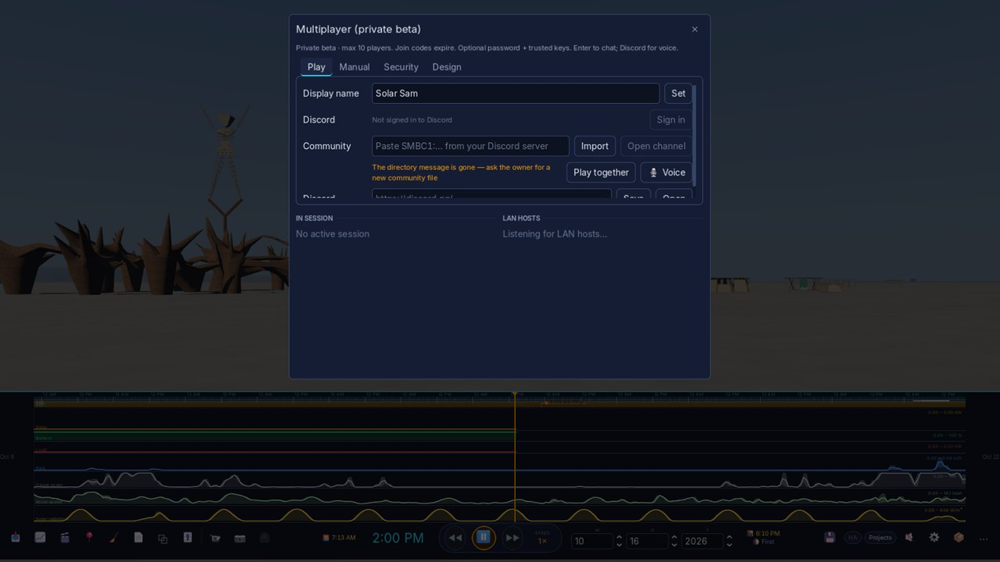

*Host or join a shared world; Discord sign-in, chat and live design sync.*

**How to open:** **Click Multiplayer**

- Click the Multiplayer chip on the timeline
- Host to get a join code, or paste one to join; Enter opens chat

A listen server with no servers of ours: the host's world, clock and simulation are authoritative, guests see the people and the graph streamed live, can possess an NPC, and a Discord community file handles identity, discovery and an optional chat mirror.

---

Generated by `tools/tour_docs.py` from tour run tour_20261025-215938 (2026-10-25T22:01:31, commit f886c8a; 1/1 stops passed). Regenerate with `tools\tour.ps1 -Mode stills` then `python tools/tour_docs.py`. Add a feature: copy `core/tour/stops/_template.gd`.
